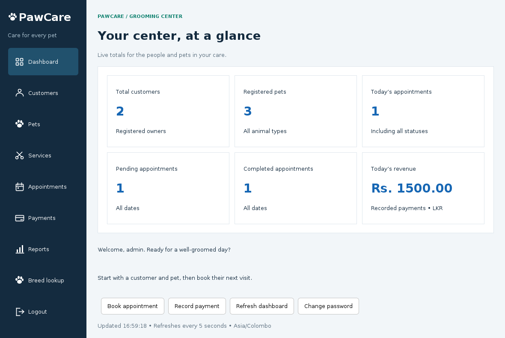
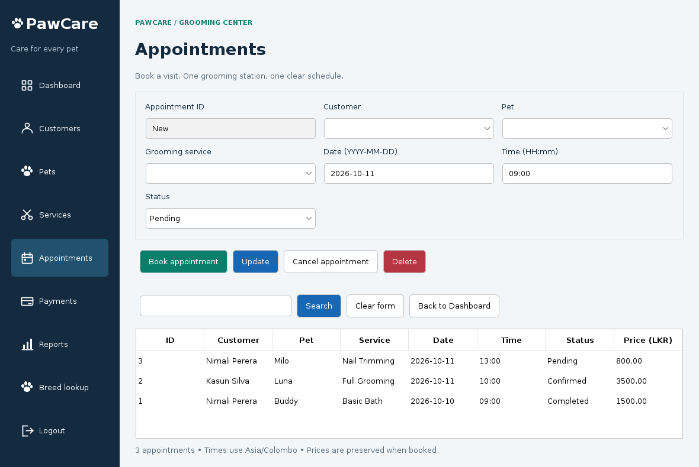

# PawCare — Pet Grooming Center Management System

A complete Java Swing coursework project for a Diploma in Software Engineering. Built as an ordinary Maven desktop application that opens in NetBeans, with paired `.java` and `.form` GUI Builder files.

## Features

- Nine connected windows: Login, Dashboard, Customers, Pets, Services, Appointments, Payments, Reports and Breed Lookup.
- Database-backed login, salted PBKDF2 password hashes and change-password dialog.
- Full create/read/update/delete operations for customers, pets, services, appointments and payments, plus search and row-to-form selection.
- Appointments filter pets by owner, reject past or overlapping bookings, support cancellation and preserve the price/duration agreed at booking.
- One full payment per appointment, duplicate-payment protection, automatic customer/service/amount details and printable receipts.
- Live dashboard with six database statistics, refreshed on reopening and every five seconds while visible.
- Jasper appointment report, payment report and receipt; joined SQL, date filters, print preview and PDF export.
- Optional Dog CEO breed list and photo lookup, with timeouts and JSON error handling.
- Colour-coded actions and app-drawn navigation icons.
- Controller validation, checked custom exceptions and prepared SQL statements.
- Runnable JAR with dependencies, tests, sample SQL, launch scripts and feature-branch history.

## Technologies and prerequisites

| Item | Choice |
|---|---|
| Language/runtime | Java 17; use a full desktop JDK 17 or newer |
| IDE | Apache NetBeans with Java, Maven and Swing GUI Builder support |
| Desktop UI | Swing + FlatLaf 3.5.4 |
| Database | MySQL 8+ or MariaDB 10.4+ (InnoDB) |
| JDBC | MySQL Connector/J 8.4.0 |
| Reports | JasperReports and bundled fonts 6.21.3 |
| HTTP / JSON | Java HttpClient / Gson 2.11.0 |
| Build | Maven; NetBeans can supply its own Maven |
| Tests | JUnit 5 + isolated H2 database; optional MariaDB/MySQL test mode |

Actual application screenshots are in `docs/screenshots/`.

