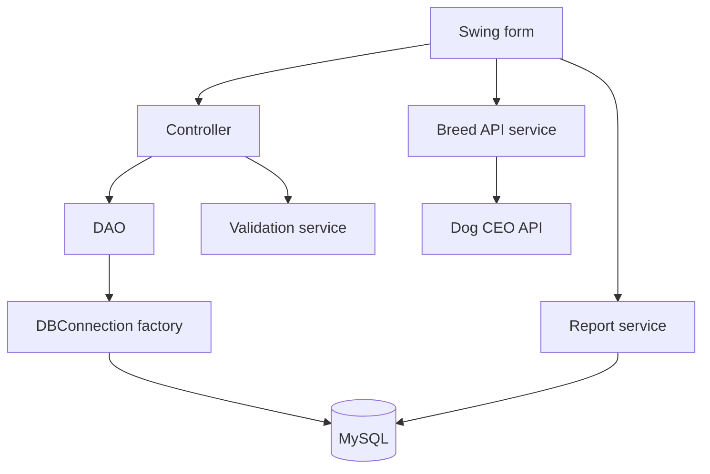
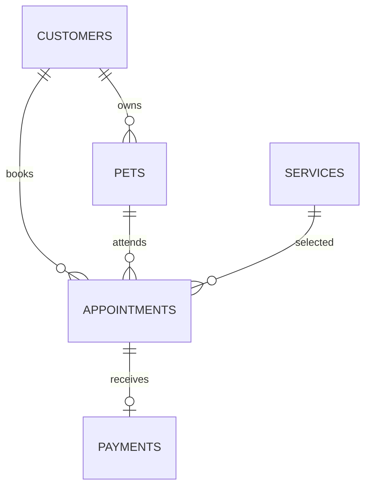

# Architecture, relationships and design decisions

## Package map

| Package | Purpose | Important files |
|---|---|---|
| `com.pawcare` | Application startup | `Main.java` |
| `model` | Plain Java objects / JavaBeans | Customer, Pet, GroomingService, Appointment, Payment, User |
| `view` | Nine editable JFrame forms, table rendering and UI events | `LoginFrame`, `DashboardFrame`, five management frames, `ReportFrame`, `BreedFrame` |
| `controller` | Validates and coordinates a user action | Login, Customer, Pet, Service, Appointment, Payment, Dashboard and Lookup controllers |
| `dao` | Prepared JDBC queries and transactions | Entity DAOs, DashboardDAO, DaoSupport |
| `service` | Reusable input and HTTP services | Validation, BreedApiService |
| `util` | Shared infrastructure | DBConnection, PasswordUtil, Session, Tasks, Ui, NavIcon, AppClock |
| `exception` | User-defined checked exceptions | ValidationException, InvalidAppointmentException, InvalidPaymentException |
| `report` | Jasper compile/fill/export | ReportService |

MVC keeps data, interface and action coordination separate. DAO hides SQL from the interface. Singleton gives one shared configuration factory, not one unsafe shared live connection. Password hashing, HTTP access and Jasper reports are separate services. Appointment and payment operations use transactions plus a calendar mutex row; this is a practical concurrency mechanism, not an additional coursework design-pattern claim.

## Database relationships

| Table | Primary key | Main fields / relationships |
|---|---|---|
| users | user_id | unique username, password_hash, role |
| customers | customer_id | name, 10-digit phone, email, address |
| pets | pet_id | customer_id FK, name, animal type, breed, gender, whole-year age |
| services | service_id | unique name, description, DECIMAL price, duration_minutes |
| appointments | appointment_id | customer_id, pet_id, service_id FKs, date, time, status, booked_price, duration_minutes |
| payments | payment_id | unique appointment_id FK, amount, method, date |
| system_locks | lock_name | one `appointments` row used only for transactional coordination |

A composite foreign key `(pet_id, customer_id)` enforces that the booked pet belongs to the chosen customer. Prices use BigDecimal/DECIMAL, not binary floating-point. Service price/duration are copied to the appointment so an edit to the service menu does not silently change an old bill. Changing to a different service deliberately refreshes both snapshots. Customer and service names remain current when they are edited; the reports are not an immutable accounting archive.

Full payment is enforced by the controller/DAO and a unique appointment ID. The application records payment details only; deleting a record does not perform a bank refund. The small lock row prevents two applications from both approving the same vacant appointment slot. All code paths that change appointments/payments take that lock first, inside a transaction.

CRUD: INSERT creates a record; SELECT reads it; UPDATE changes it; DELETE removes it. Appointment cancellation is a separate UPDATE that preserves history. Foreign keys use RESTRICT instead of silently cascading deletions.

## UI colour choices

| Colour | Where used | Design intention |
|---|---|---|
| Navy `#142B3F` | Sidebar and headings | Stable, calm visual structure |
| Blue `#1767B4` | Update/search actions and statistics | Familiar information/action cue |
| Green `#097E6B` | Save, book, sign in | Care and successful progress |
| White / pale gray `#F2F6F9` | Cards and working area | Readability and space around forms |
| Red `#B53542` | Delete | Visually prominent destructive action |
| Gray | Secondary actions and explanatory labels | Lower visual priority |

These are design intentions, not universal psychological effects. Button text and icons identify actions as well as colour. Orange was suggested in the brief but is intentionally omitted to keep the palette restrained. Icons are small vector drawings in `NavIcon`, avoiding missing image-path errors.

## Error handling

Validation errors use checked exceptions and readable messages. Database constraints report a friendly explanation. Report and API errors appear in a dialog; stack traces remain available in the console. Dashboard background refresh uses a status message to avoid repeated modal dialogs during an outage. Local JDBC connections, statements, result sets and resource streams are closed with try-with-resources.

`InvalidAppointmentException` and `InvalidPaymentException` extend the project's `ValidationException`, which extends `Exception`. Their code includes explicit `throw new ...`. Controllers expose those failures to views; views or SwingWorker completion handlers catch them and call `Ui.error`.

## Deliberate scope

One trusted center desktop, a local or configured database, one grooming station, one service per appointment, one full payment, and an admin-oriented interface. The stored role is informational; fine-grained roles, remote access control, audit trails and commercial multi-branch operations are future extensions. The shipped administrator password and example customer details are demonstration data.
